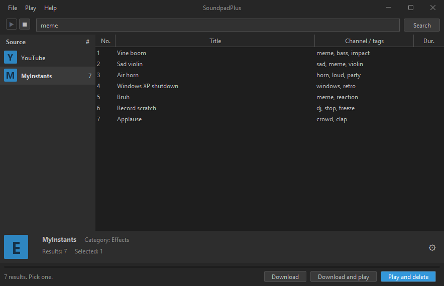
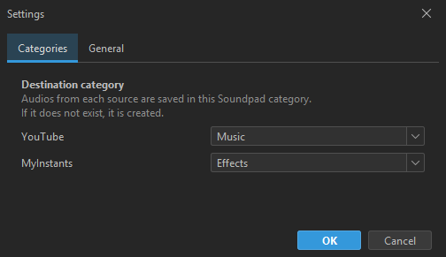

# SoundpadPlus

Desktop app (Kotlin + Swing/FlatLaf) that searches audios on online sources, downloads them and adds them to
[Soundpad](https://www.leppsoft.com/soundpad/) through its Remote Control API. Sources are plugins, so anyone can add one.





## Install

Download `SoundpadPlus-x.y.z.exe` from the [latest release](https://github.com/system32developer/SoundpadPlus/releases/latest)
and run it. It installs per user (no admin rights) and the app updates itself from GitHub releases
(Settings → General to turn it off, Help → Check for updates to check now).

Requirement: Windows 10/11 with **Soundpad running** (Remote Control enabled).

YouTube and MyInstants are plugins like any other: they ship inside the app and are copied to its `plugins` folder.
The YouTube plugin asks the app to download `yt-dlp` and `ffmpeg` (about 130 MB) into the `tools` folder on the first start,
checking their SHA-256, which keeps the installer small. Updating keeps your settings, plugins, languages and tools.

## Files next to the app

Everything the app stores is in its own folder (right click the shortcut → *Open file location*):

```
SoundpadPlus/
├── SoundpadPlus.exe
├── settings.properties   categories, language, auto-update, approved plugin hashes
├── plugins/              YouTube.jar, MyInstants.json and any plugin you add (see below)
├── lang/                 en.properties and es.properties (editable), plus any language you add
└── tools/                files that plugins declared as dependencies (yt-dlp.exe and ffmpeg.exe), downloaded on first start
```

Downloaded audios go to `Music/SoundpadPlus`. When running from source the same files live in `run-data/`.

## Build from source

Requirements: JDK 21 (Gradle downloads it if missing).

| Command | Result |
|---|---|
| `gradlew run` | Starts the app (files in `run-data/`) |
| `gradlew test` | Runs the tests (also builds the example plugin and loads it) |
| `gradlew packageApp` | Portable app with its own JRE in `build/dist/SoundpadPlus/` |
| `gradlew packageInstaller` | Per-user `.exe` installer in `build/dist/` (needs [Inno Setup 6](https://jrsoftware.org/isinfo.php); language choice and an "open the program" checkbox; replaces the old MSI install) |

### Releasing a version

1. Bump `appVersion` in `build.gradle.kts` (Windows only upgrades to a higher version, and the updater compares it with the tag).
2. `gradlew packageInstaller`, then create the checksum file next to the installer:
   `sha256sum SoundpadPlus-X.Y.Z.exe > SoundpadPlus-X.Y.Z.exe.sha256`.
3. Publish a GitHub release tagged `vX.Y.Z` with **both** files attached
   (`gh release create vX.Y.Z build/dist/SoundpadPlus-X.Y.Z.exe build/dist/SoundpadPlus-X.Y.Z.exe.sha256`).
   Running apps find it, download the installer, verify the SHA-256 and offer to install it.

## Adding sources (plugin API)

A source only has to **search** and say **where each audio is**. The app handles the UI, the Soundpad category,
adding the sound, playing it and removing it. There are two kinds of plugin, both dropped in the `plugins` folder
next to the app (restart the app afterwards).

| | JSON plugin (recommended) | Jar plugin |
|---|---|---|
| Contains code | No | Yes (Kotlin/Java) |
| Can do | Call HTTPS URLs on the hosts it declares, read a JSON list, download the audios it points to | Anything |
| Permissions | Only those | **Everything the user can do** |
| Loaded | Automatically | Only after the user approves its SHA-256 |

### JSON plugin

Use it when the source has a JSON API that returns direct links to audio files. See `examples/json-source/example.json`.

```json
{
  "id": "my-source",
  "name": "My Source",
  "defaultCategory": "Effects",
  "searchHint": "Search my source…",
  "hosts": ["api.example.com", "cdn.example.com"],
  "searchUrl": "https://api.example.com/search?q={query}",
  "resultsPath": "data.items",
  "fields": { "title": "name", "subtitle": "tags", "duration": "length", "audioUrl": "files.mp3" }
}
```

- `hosts`: the only hosts (and their subdomains) the plugin may talk to. Search URL and audio URLs must be `https` and match one.
- `resultsPath`: dotted path to the list in the answer. `fields`: dotted path of each value inside an item
  (`title` and `audioUrl` are required). Up to 50 results are used.
- Preview (double click) is offered for `.mp3` links.
- `audioBase` (optional): text put in front of the `audioUrl` value, for APIs that return relative paths. It must be an https URL on a declared host.
- `headers` (optional): extra request headers (letters, digits and basic punctuation only), sent only with the search request.
- Real example: `src/main/resources/plugins/MyInstants.json` (bundled). `examples/json-source/tuna.json` adds Voicemod's Tuna (uses `headers`).
- Real example: `examples/json-source/memesoundboard.json` adds [memesoundboard.org](https://memesoundboard.org/); copy it to the `plugins` folder and restart.

### Jar plugin

Use it when you need real code (scraping, a local tool, a non-JSON API).

```kotlin
class MySource : AudioSource {
    override val id = "my-source"                // unique and stable: settings are stored under it
    override val name = "My Source"              // shown in the source list
    override val defaultCategory = "Effects"     // Soundpad category until the user changes it
    override val searchHint = "Search my source…"

    override fun search(query: String): List<Entry> =       // runs on a background thread
        listOf(Entry("Title", "Subtitle", previewUrl = "https://…/a.mp3", duration = "0:05") { progress ->
            Downloads.fromUrl("https://…/a.mp3", "Title", progress)   // returns the saved File
        })
}
```

- `Entry.download` must save the audio and return the `File`. Report progress with `progress(0..100)`, or `progress(-1)` if unknown.
  Use `Downloads.dir` and `Downloads.safeName(...)` for files (Soundpad only understands ANSI paths).
- Use `Downloads.open / readText / fromUrl` for network access: they only allow HTTPS, block private and local addresses,
  check every redirect and cap sizes (2 MB text, 100 MB audio).
- Throw an exception with a readable message to show an error in the status bar.
- Need an external program? Override `dependencies` with a list of `Dependency(name, fileName, url, hosts, checksumUrl, …)`.
  The app downloads the missing ones into `tools` at start-up, checks their SHA-256 and shows the progress; read the file
  back with `dependency.file`. See `plugins/youtube` (the bundled YouTube plugin) for yt-dlp and a zipped ffmpeg.
- Gson and JLayer are on the classpath.

Packaging:

1. Create a Gradle project with `compileOnly` on the app (see `examples/example-source/build.gradle.kts`;
   outside this repo use `compileOnly(files("path/to/SoundpadPlus.jar"))`).
2. Register the class in `src/main/resources/META-INF/services/com.emprecio.soundpadplus.api.AudioSource`
   (one fully qualified class name per line). It needs a public no-argument constructor.
3. Build the jar and copy it to the `plugins` folder. On first start the app shows the file name and its SHA-256 and asks
   for permission. The approval is stored for that exact file: any change to the jar asks again.

A plugin with an id already in use, or one that fails to load, is skipped and the reason is printed to stderr.
The packaged app ships a trimmed JRE (desktop, logging, naming, management, net.http, crypto): if your plugin needs other
JDK modules, add them to `--add-modules` in `build.gradle.kts`.

## Languages

Texts live in `src/main/resources/i18n/<code>.properties` (UTF-8, `{0}`, `{1}`… are arguments). English is the fallback for
missing keys. To add a language, copy `en.properties`, translate the values and set `language.name`. Either:

- put it in `src/main/resources/i18n/` and add its code to `bundled` in `I18n.kt`; or
- (for users) drop it in the `lang` folder next to the app as `<code>.properties`; no rebuild needed.

The app copies `en.properties` and `es.properties` into the `lang` folder on first start, ready to edit or copy as a template.
A file there overrides the bundled text key by key, so keys you remove still fall back to the built-in ones.

The language is chosen in Settings → General (default: system language) and changes immediately.
A test checks that every bundled language has the same keys as English.

## License

[MIT](LICENSE). `yt-dlp` (Unlicense) and `ffmpeg` (GPL build from gyan.dev) are downloaded by the app on first start,
not distributed with it, and keep their own licenses.
